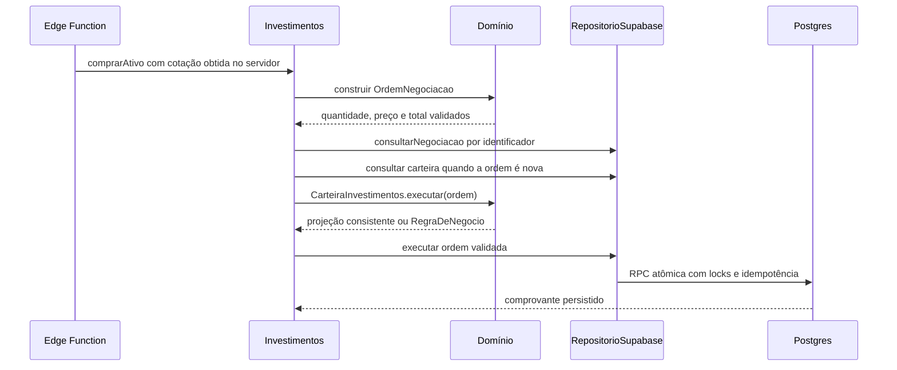

# Modelo de domínio e regras de negócio

O foco desta implementação é comportamento nas classes, além de cadastro e consulta.
O domínio pode ser executado e testado sem navegador, API de mercado ou Supabase.

## Responsabilidades

| Classe | Comportamentos do negócio |
| --- | --- |
| `Dinheiro` | Soma, subtração, comparação, limite de saldo e cálculo do total de uma quantidade sem ponto flutuante. |
| `Quantidade` | Soma e subtração em milionésimos, limite de quantidade e impedimento de venda acima da posição. |
| `Conta` | Crédito, débito e preparação de Pix com saldo suficiente e destino diferente da própria chave. |
| `Posicao` | Aumenta quantidade na compra e reduz na venda, impedindo operações com quantidade zero ou superior à disponível. |
| `OrdemNegociacao` | Valida ticker, UUID e valores; calcula custo/provento; reconhece repetição e rejeita identificador reutilizado com outros dados. |
| `CarteiraInvestimentos` | Coordena a mudança conjunta de saldo e posições, compra, venda parcial, encerramento da posição, aporte e retirada. |

Os objetos são imutáveis: os métodos retornam um novo estado. Se uma regra falhar,
o objeto anterior continua intacto, sem débito parcial nem posição alterada.
`Ativo` e `Movimentacao` continuam representando catálogo e registro histórico;
não é necessário inventar comportamento para cada classe de dados.

## Fluxo real de uma compra



O serviço não calcula o total nem decide se a carteira tem saldo ou quantidade:
essas regras estão no domínio. Ele coordena consultas, aplicação das regras e persistência.
O adaptador reconstitui ordens anteriores usando o cliente com sessão, protegido por RLS.
Pix chama `Conta.prepararPix` antes de consultar câmbio ou gravar a transferência.

## Repetições e concorrência

Uma ordem já concluída não deve falhar por causa do estado posterior da carteira:
vender tudo e repetir o pedido não pode causar um novo crédito nem erro de posição.
Por isso o serviço procura a ordem anterior antes de validar a carteira atual.
Se outra requisição concluir entre essa procura e a leitura do saldo, ele procura
novamente ao detectar a recusa do domínio. Reutilização com dados diferentes é recusada.
Uma mudança de preço entre tentativas continua sendo conflito, como já era no SQL.

A projeção calculada no domínio **não é enviada como um saldo absoluto ao banco**.
O banco mantém a autoridade transacional: revalida saldo, quantidade, arredondamento
e identificador sob locks. Isso evita que duas requisições que leram o mesmo saldo
gastem o mesmo dinheiro. A validação em classes não substitui as garantias do banco.

Não há migração nova ou mudança de contrato HTTP. A função `corretora` precisa ser
republicada para ativar as novas regras no ambiente hospedado; a refatoração da branch
não executa esse deploy nem operações financeiras.

## Demonstração para a apresentação

1. `tests/negociacao.test.ts`: posição com duas unidades recusa venda de três.
2. Compra de duas unidades a R$ 10 reduz R$ 100 para R$ 80; venda parcial e
   venda final atualizam posição e saldo. O objeto inicial permanece intacto.
3. `0.5 × 44.43`: compra custa R$ 22,22 e venda gera R$ 22,21, com política explícita.
4. Pix para a própria chave ou sem saldo é recusado por `Conta`, sem acessar banco.
5. `tests/investimentos.test.ts`: o serviço não chama a gravação quando o domínio
   recusa; repetição já concluída continua seguindo para a RPC idempotente.
6. `supabase/tests/repositorio-supabase.test.ts`: reconstrução das ordens anteriores
   e filtro por identificador, sem conexão com banco real.

```powershell
npm.cmd test
deno test supabase/tests
npm.cmd run build:front
```

Esses testes não fazem operações no projeto hospedado. Os testes SQL existentes
continuam separados e exigem banco de testes com migrações aplicadas.
